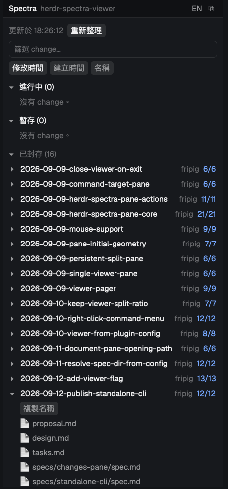

# spectra-viewer

Herdr 桌面版（herdr-app）的 mod 與 layout：在右側面板（或浮動視窗）列出目前 space 所在專案的 [Spectra](https://spectra.5xcamp.us/) change——進行中、暫存（parked）、已封存三組，顯示任務進度與提案人，點文件就用 markdown 檢視，一鍵把 `/spectra-*` 指令打進你正在用的 terminal。

從零重建的說明（給其他 agent 照著做）見 [RECIPE.md](RECIPE.md)。

功能參考 JetBrains 外掛 [idea-spectra-viewer](https://github.com/fripig/idea-spectra-viewer)，架構沿用 [herdr-mod-issue-launcher](https://github.com/fripig/herdr-mod-issue-launcher)。直接讀檔案，不需要開 Spectra app，也不碰它的資料庫。



> 非官方專案，與 Spectra 無關聯。

## 功能

- **跟著目前的專案**：取目前 space 焦點 pane 的資料夾（沒有就用 space 資料夾），`git rev-parse` 找出 repo 根目錄；切 space 就換專案。焦點在 mod pane（例如文件檢視）時保持原本的專案。
- **spec 目錄**：依 Spectra 的規則讀 `.spectra.yaml` 的 `spec_dir`，沒寫就是 `openspec`；不看磁碟上有哪些資料夾。設定不能用（指到專案外、空的）時顯示一行警告並改用 `openspec`。
- **三組**：進行中（`<spec_dir>/changes/`）、暫存（git 目錄下的 `spectra-app/changes/`，worktree 也會透過 `--git-common-dir` 找到）、已封存（`<spec_dir>/changes/archive/`，預設收起）。篩選中組名顯示「符合數/總數」。
- **任務進度**：解析 `tasks.md` 的 checkbox，顯示「完成/總數」，code block 裡的不算；全部完成、進行中、未開始各有顏色。
- **提案人**：`.openspec.yaml` 的 `created_by`，只顯示名字、去掉 email。
- **排序**：修改時間（預設，最新在前）、建立時間、名稱；沒有日期的排最後。
- **篩選**：依名稱即時篩選（不分大小寫），超過一位提案人時多一排作者按鈕。排序與篩選只重排，不重新掃描。
- **展開 change**：
  - `discuss`／`apply`／`ingest`／`archive`／`commit`：把 `/spectra-<指令> <change 名稱>` 打進目標 terminal 的提示列，**不按 Enter**，然後把焦點切過去。目標是目前焦點的 terminal；焦點在 mod 上時改用目前分頁的第一個 agent。找不到 terminal 就改為複製到剪貼簿。已封存的 change 不顯示這排。
  - 複製名稱：只複製名稱本身。
  - 文件：點了在浮動視窗用 markdown 顯示（同一個視窗重複使用）；視窗裡「開在旁邊」可改成右側 pane。檔案存檔後自動重新載入。
- **自動更新**：本機專案監看 spec 目錄與暫存目錄，有變動就重掃；另外每 30 秒、切換專案時、按「重新整理」也會重掃。展開狀態、收合、排序、作者選擇都會記住。
- **遠端 space**：在 space 所在的機器上執行 `git`／`sh`／讀檔；遠端不監看，靠 30 秒計時器。
- **中英文介面**：依系統語系決定，標題列的 **EN／中** 可切換（共用設定 `spectra-viewer.lang`）。

## 需求

- Herdr 桌面版（herdr-app）0.1.16 以上
- `git`、`sh`、`find`、`stat`、`awk`（macOS／Linux 內建）
- 複製：macOS `pbcopy`；Linux `wl-copy`、`xclip` 或 `xsel`

## 安裝

```sh
scripts/install.sh
herdr-app check ~/.config/herdr-app/mods/spectra-viewer
herdr-app do layout.switch --name spectra-viewer   # 或 cmd-shift-l 切換
```

`install.sh` 把 `mods/spectra-viewer/` 複製到 `~/.config/herdr-app/mods/spectra-viewer/`，把 `layouts/spectra-viewer.json` 複製到 `~/.config/herdr-app/layouts/`；不是它裝的同名資料夾或 layout 會拒絕覆蓋，安裝後手改過的 layout 也會拒絕（`--force` 強制覆蓋並備份成 `.bak-<時間>`）。它不會幫你切換 layout。

### spectra-viewer layout

Herdr app 0.1.16 的 `main` 加兩處修改：分頁列右側多一個 **Spectra** 按鈕，右側面板多一個 `spectra` 區塊，跟 Files／Changes 共用同一個面板。

- 停靠面板的 **⧉**：收起右側面板，改成可拖曳的浮動視窗。
- 浮動視窗的 **⇲**：回到右側面板；**✕**：關閉。
- 不切 layout 也能用：`herdr-app do mod.open --name spectra-viewer` 開浮動視窗。

### issues-spectra layout（和 issue-launcher 一起用）

如果也裝了 [issue-launcher](https://github.com/fripig/herdr-mod-issue-launcher)（`~/.config/herdr-app/mods/issue-launcher/` 存在），`install.sh` 會另外裝 `layouts/issues-spectra.json`：分頁列右側同時有 **Issues** 和 **Spectra** 按鈕，兩個面板都停靠在右側，跟 Files／Changes 共用。沒裝 issue-launcher 時會略過這份 layout 並印出原因。

```sh
herdr-app do layout.switch --name issues-spectra
```

## 開發

```sh
npm test                    # node --test：logic.js 與 i18n.js 的單元測試（含對真實資料夾跑掃描腳本）
scripts/install.sh          # 改完重新安裝，Herdr 會熱重載
herdr-app check ~/.config/herdr-app/mods/spectra-viewer
```

不依賴 Herdr 的邏輯放在 `mods/spectra-viewer/logic.js`，畫面與 Herdr 呼叫放在 `main.js`。

## 沒有做的

- 右鍵選單（指令改成展開 change 後的按鈕列）
- 多選 change 一次複製多個名稱
- 修改 change、park／unpark、執行 Spectra CLI
