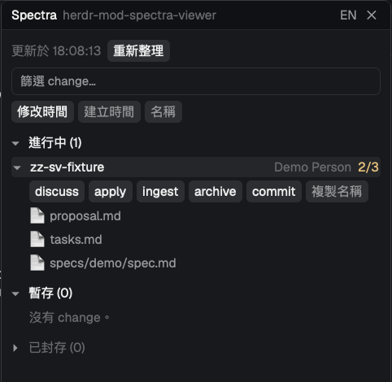

# Spectra viewer

A right-side panel, with a Spectra button next to Files and Changes, that lists the Spectra changes of the project you are working in: Active, Parked and Archived, each with its task progress and proposer. Expanding a change shows its Markdown artifacts, which open in a Markdown window, and five buttons that type `/spectra-discuss|apply|ingest|archive|commit <change>` at your terminal's prompt without pressing Enter.

This file is the brief: enough to build Spectra viewer from an empty folder. The files next to it (`mods/spectra-viewer/`) are one build of it. The panel speaks English or Traditional Chinese; the examples below quote the Chinese text.

## What you see

The `spectra-viewer` layout: Herdr's `main` layout (Herdr app 0.1.16) with two additions.

- **Spectra button**, in a 98px block right of the tab bar, at its 42px height: theme `chrome` background with a 1px `border` line underneath. The button copies the shipped Files and Changes buttons: 26px high, 8px padding, 5px gap, 6px corners, 12px text, a 14px document icon (`spectra.svg`). While the right panel shows Spectra it uses `selected` with `foreground` text, otherwise `chrome` with `muted` text.
- **Spectra panel**, a third child of the right panel stack after Files and Changes (368px, resizable 280–900px).

The same panel also opens as a Herdr window (`kind: "window"`), 400px wide and 80% of the window's height, reopened where it was left.

The panel, top to bottom:

1. **Title row**, 30px, `chrome`, 1px `border` underneath: "Spectra" (semibold), then the project folder's name in `dim`. On the right: the language chip (EN or 中); docked: ⧉; window: ⇲ (only when the layout has the Spectra panel) and ✕.
2. **Header**, then a scrolling body; 10px padding, 10px gaps, 13px text on `surface`:
   - "更新於 HH:MM:SS" in `dim` and a 重新整理 chip.
   - A 28px filter box (6px corners, `border`, `background`), placeholder "篩選 change…".
   - Sort chips 修改時間 · 建立時間 · 名稱; the chosen one `selected`, others `raised` with `muted` text.
   - With more than one proposer: an author row, 全部 plus one chip per proposer.
   - Messages: a `blocked`-colored warning for an unusable `.spectra.yaml`, "這裡沒有 Spectra：找不到 docs/spectra。" in `muted`, a red (`ansi1`) "掃描失敗：<reason>".
   - Three groups: ▾/▸, then 進行中 (n), 暫存 (n), 已封存 (n) semibold; 已封存 in `dim`. While filtering, the count reads `shown/total`. An empty group shows "沒有 change。" or "沒有符合的 change。".
   - Each change row: ▸/▾, the name (truncated), the proposer in `dim`, and `done/total` colored by status: all done `done`, some done `working`, none done `muted`. No tasks: nothing shown.
   - Expanded, indented 18px: a wrap row of chips `discuss` `apply` `ingest` `archive` `commit` (not on archived changes) and 複製名稱 (`muted`), then one row per artifact, "📄 <relative path>" in `muted`, `foreground` on hover.

Chips: 6px horizontal padding, 5px corners, `raised`, `hover` on hover. All colors come from `theme()`.

The document window: 50% × 85% of the Herdr window, keyed `spectra-viewer-doc` so opening another artifact replaces it. Title row as above with the last three path segments, and 重新載入, 開在旁邊, ✕. Body: `TextView.markdown` with 16×12px padding.

## How it behaves

- **Which project:** the active space's focused pane folder, else the focused terminal's folder, else the space folder, on the space's machine. While a mod pane has focus (it has no folder) the panel keeps its project. `git rev-parse --path-format=absolute --show-toplevel --git-common-dir` gives the root and the common git dir (worktrees share it); outside git the folder itself is the root and nothing is parked. A 1-second timer notices a new folder or machine and rescans only when the root changed.
- **Spec dir:** `spec_dir` from the root's `.spectra.yaml` (top-level key, quotes and `# comments` stripped), else `openspec`. Absent folders don't change the answer. An absolute path, a `..` escape, an empty or a non-scalar value warns and uses `openspec`. If the folder doesn't exist the panel says so and lists nothing.
- **Groups:** Active = folders in `<spec>/changes/` except `archive`; Archived = folders in `<spec>/changes/archive/`; Parked = folders in `<git common dir>/spectra-app/changes/`.
- **Per change:** artifacts are every `*.md` beneath it, relative, with proposal.md, design.md, tasks.md first and the rest sorted as strings. Progress counts `- [ ]`, `- [x]`, `- [X]` (also `*`, `+`) lines outside fenced code; other marks don't count. Modified = newest artifact mtime. `.openspec.yaml`: `created` (YYYY-MM-DD, or the date part of a timestamp) and `created_by` (text before `<`).
- **Sort:** modified (default) or created, newest first, unknown last, ties by name; or by name. **Filter:** name substring, case-insensitive, plus the chosen proposer. Sorting and filtering never rescan.
- **Collapse:** click a group header. At first only 已封存 is folded. Click a change row to expand it. Sort, author, folded groups and expanded changes are kept in `localStorage`.
- **Refresh:** on start, every 30s, on 重新整理, and — for local projects — whenever `watchFolder` reports a change under the spec dir or the parked dir. While scanning the chip reads 讀取中… and clicks queue one more scan.
- **Commands:** a command chip types `<command> <name>` into the target terminal with `hc keys <terminal> <one key per character>` (space as `space`), never Enter, then `pane.focus {terminal}`. Target: the focused terminal pane; else the shown tab's first agent; else its first terminal. With no target, or a name with characters other than letters, digits, `-_./`, the line is copied instead and a toast says so.
- **Copy:** `printf %s "$1" | pbcopy` (macOS), else `wl-copy`, `xclip -selection clipboard` or `xsel`. A success toast, 2.5s.
- **Artifacts:** a click opens the document window. 開在旁邊 runs `pane.split {direction: "right", mod: "spectra-viewer", props: {role: "viewer", file, on}}` and closes the window. A local document reloads when its folder's watch reports the file.
- **Spectra button:** shows the right panel on Spectra, or toggles it when Spectra is already shown; adds `spectra` to shared `workspace.panels`.
- **Languages:** detected once per copy (`defaults read -g AppleLanguages` on macOS, `LANG` elsewhere), overridden by shared `spectra-viewer.lang`. Change names, paths and proposers are never translated.
- Agent statuses don't appear in this panel. Nothing animates.

## Built from

- **The layout**, `layouts/spectra-viewer.json`: a copy of `main.json` with every id kept. `panel-body` gains `{ "id": "spectra", "type": "block", "content": { "mod": "spectra-viewer" } }`; the `tabs` block becomes weight 1 inside `{ "id": "tabs-row", "type": "row", "resizable": false, "size": { "px": 42 } }`, followed by `{ "id": "spectra-button", "type": "block", "size": { "px": 98 }, "content": { "mod": "spectra-viewer", "props": { "role": "button" } } }`.
- **One mod**, `mods/spectra-viewer/`, three roles by `props().role`: `"button"`, `"viewer"` (`{file, on}`), none = the panel.
  - `mod.json`: `{ "place": "none", "title": "Spectra", "overlay": { "kind": "window", "key": "spectra-viewer", "keep": true, "width": 400, "height": 0.8 } }`.
  - `logic.js`: pure functions (spec dir, YAML scalars, task progress, metadata, `SCAN_SCRIPT` and `parseScan`, sort/filter, key names, target terminal, panel commands).
  - `i18n.js`: `en` and `zh-TW` strings.
  - `main.js`: the View.
- **The scan** is one `exec("sh", ["-c", SCAN_SCRIPT, "spectra-viewer", <changes dir>, <parked dir or "">], {on})`. It prints records starting with `\036`: `D <group> <dir>` per change folder, `M <mtime> <path>` per Markdown file (`stat -c` on GNU, `stat -f` on BSD, via `find -exec … +`), `T <path>` followed by the text of each `tasks.md` / `.openspec.yaml` (via `awk`), and a final `E`. Missing `E` means the scan failed.
- **herdr data:** `spaces()`, `focused()`, `panes()`, `agents()`, `theme()`, `layout()`, `shared()`, `props()`, `window()`.
- **herdr calls:** `exec` (`git`, `test`, `sh`, `defaults`), `hc(["keys", …])`, `readTextFile`, `watchFolder`, `run` (`pane.focus`, `pane.split`, `layout.toggle|select|show|hide`), `openOverlay`, `closeOverlay`, `notify`, `setShared`.
- **Programs it runs:** `git`, `sh` with `find`/`stat`/`awk`, `test`, `pbcopy`/`wl-copy`/`xclip`/`xsel`, `hc`. No network. It reads only inside the project and its git dir, plus Herdr's `layouts/.state/`.

## Watch out

- **`hc send` presses Enter.** To leave the command at the prompt use `hc keys` with one key name per character. Uppercase letters become `shift+<letter>`; anything outside letters, digits and `-_./` is refused and copied instead.
- **A mod pane has no folder.** Without the "keep the project while a mod pane is focused" rule, opening a document beside the terminal makes the panel jump to the space folder (often `~`) and report no Spectra.
- **`herdr-app shot` returns the last frame drawn.** Change something (touch a tasks.md) before shooting.
- **No Node APIs:** the `fs/promises` module has no `stat`, and only works locally; the single shell script works the same on remote spaces.
- **Don't symlink the mod**; copy it (`scripts/install.sh`). `layout()` doesn't report the panel's shown/hidden click, so the button toggles and reads `layouts/.state/<layout>.json` twice a second for its highlight (Herdr's own file: read-only, may change).
- **Stop mouse-down on every control** (`cx.stop_propagation()`), or pressing it drags the window. Esc doesn't close a window, so ✕ is required.
- **The layout is a snapshot of `main` from 0.1.16** and holds only this mod's button; Issue launcher's layout is another snapshot with only its own.
- Remote spaces aren't watched; they rely on the 30s timer.

## Done when

- `herdr-app check ~/.config/herdr-app/mods/spectra-viewer` prints `check passed`, and `npm test` passes (it runs `SCAN_SCRIPT` on a real fixture folder).
- In a project with `.spectra.yaml` `spec_dir: docs/spectra`, the groups list the same folders as `ls docs/spectra/changes docs/spectra/changes/archive`, and parked changes from `.git/spectra-app/changes`.
- Adding a folder under `changes/` shows it within a few seconds without clicking; ticking a task updates `done/total`.
- A `created_by: Name <mail>` shows only "Name"; a checkbox inside a code fence isn't counted.
- Filtering "add" shows `1/3`-style counts; sorting by name reorders without changing "更新於".
- `apply` on a change leaves `/spectra-apply <name>` at the focused Claude Code prompt, not submitted, and focuses that terminal.
- Clicking an artifact opens it rendered; editing the file updates the window; 開在旁邊 moves it into a pane, and the panel keeps showing the same project.
- In the `spectra-viewer` layout, Spectra shows and hides the right panel, highlighted while shown; ⧉ pops it out and ⇲ docks it back.
